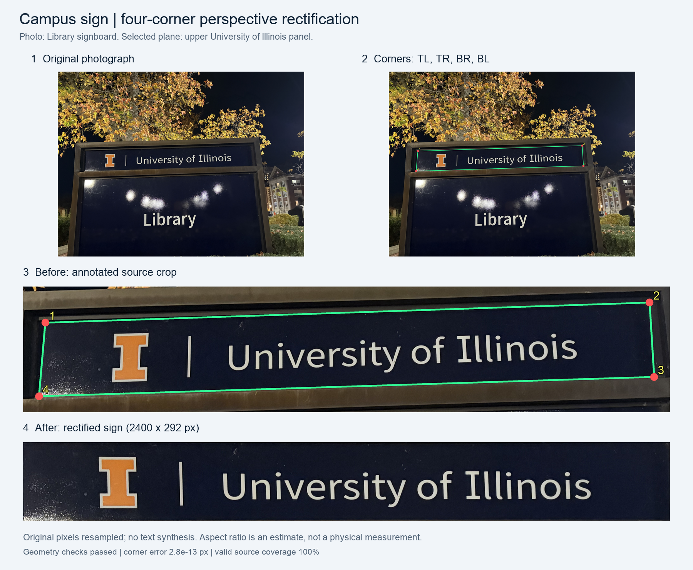

# Preserving Text in Neural Style Transfer

Compare text readability in stylized campus-sign photographs using perspective rectification and Sobel edge preservation.

## Current modules

- **VGG-19 NST and Sobel pilot — Lanting Lu:** see [PILOT_README.md](PILOT_README.md) for baseline/edge-weight runs and [HANDOFF.md](HANDOFF.md) for team responsibilities.
- **Four-corner rectification pilot — Ziyang Li:** see [rectification/library_demo](rectification/library_demo/README.md) for one annotated campus-sign photograph, a reusable OpenCV implementation, validation records, a runnable notebook, and before/after results.
- **Pending team integration:** full photo collection, P1–P4 processing pipelines, and formal OCR/CER evaluation.

## Run the rectification example

From the repository root:

```bash
python -m pip install -r rectification/library_demo/requirements.txt
python rectification/library_demo/rectify_sign.py
```

Results are written to `rectification/library_demo/results/`. Open `rectification/library_demo/demo.ipynb` with its working directory set to that notebook's folder for the notebook version.



The selected plane is the fully visible upper **University of Illinois** panel. The lower Library panel is not fully visible in the photograph. Target aspect ratio is estimated rather than physically measured; this is a geometric pilot, not evidence of improved OCR accuracy or a completed four-pipeline experiment.
