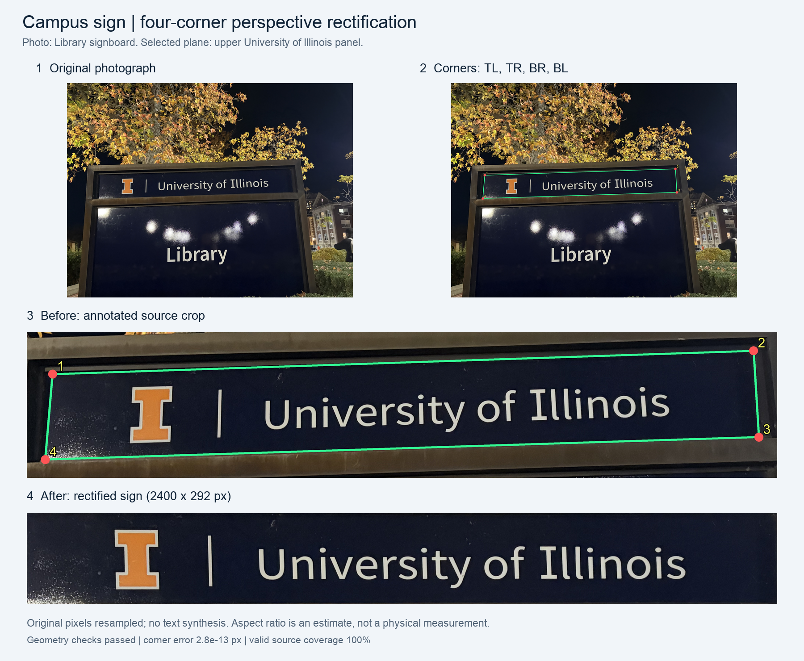

# Library 招牌照片：四角标注与透视矫正

本样例完成 Ziyang Li 的第一阶段工作：一张真实照片、人工四角标注、单应性透视矫正、可复现代码及对照图。尚未进行风格迁移或正式 OCR 实验。



## 已完成的结果

- `source.jpg`：群聊原始 JPEG 的原样副本；原图 5712 × 4284，方向标签为空。
- `annotations.json`：原图坐标、角点顺序、目标尺寸、来源 SHA-256 和选择理由。
- `rectify_sign.py`：可运行脚本，也可导入 `rectify_image()` 接入现有 NST 流程。
- `results/comparison.png`：原图、全图标注、局部标注、矫正结果四部分对照图。
- `results/corners_detail.png`：高分辨率角点局部图。
- `results/rectified.png`：2400 × 292 的矫正结果，保持 RGB，无锐化、文字重绘或其他光度处理。
- `results/validation.json`：正向和逆向单应矩阵、几何验证结果及软件版本。
- `demo.ipynb`：可重新运行的 Notebook；放在本目录运行。

## 为什么选上方的面板

照片下方的 Library 面板底边没有完整入镜，无法从这张照片标注其四个真实角点。因此选择四角完整可见的上方 University of Illinois 蓝色面板。保留橙色 I 标志；OCR 是否将标志计入标准文本应由 OCR 负责人统一约定。

角点对应蓝色印字面板的四角，顺序为左上、右上、右下、左下。坐标单位是处理 EXIF 方向后的原始像素，原点在左上。

| 角点 | x | y |
|---|---:|---:|
| 左上 TL | 672 | 1841 |
| 右上 TR | 4481 | 1714 |
| 右下 BR | 4510 | 2184 |
| 左下 BL | 632 | 2306 |

这些点是人工视觉标注，未声称达到亚像素标注精度。几何重投影误差很小，只说明矩阵准确映射了给定的四个点，不代表点位本身绝对精确。

## 复现

在本目录运行：

```bash
python -m pip install -r requirements.txt
python rectify_sign.py
```

输出到 `results/`。重复运行会重新生成该目录中本脚本负责的同名文件；保留不同配置时可指定另一个目录：

```bash
python rectify_sign.py --annotation annotations.json --output-dir results_repeat
```

脚本先校验原图哈希与尺寸，再估计四点单应性，以双线性插值进行透视变换。方法使用 OpenCV 的 [getPerspectiveTransform 与 warpPerspective](https://docs.opencv.org/4.x/da/d54/group__imgproc__transform.html)。

## 已执行的验证

- 四角被映射到目标矩形四角，最大重投影误差约 2.84e-13 像素。
- 目标图上 9 × 5 个网格点经过逆变换和正变换，最大往返误差约 9.33e-13 像素。
- 输出像素的有效原图覆盖率为 100%，没有采样到图像外部。
- 单位变换逐像素保持输入；交叉角点、越界角点和退化小区域被拒绝。
- 人工查看局部标注与最终矫正图：标志和完整 University of Illinois 文字保留，未发生镜像或旋转。

## 尺寸与实验边界

目标尺寸 2400 × 292 的宽高比由照片中两组对边的平均长度近似选定。单张未标定的透视照片加四个角点，不能唯一恢复招牌的真实物理宽高比。本结果是边框矩形化样例，不声称恢复了精确物理形状。正式实验应使用实测宽高比，或为同一块招牌预先固定并记录统一目标比例。

照片的实际拍摄角度未测量，记录为 `oblique_unmeasured`，没有虚构角度数值。原图反光、镜头畸变及板面可能存在的非平整均未另行校正。几何验证不等于 OCR 改善；CER 需要后续用人工转录统一评估。

## 后续接入四条流程

```python
from rectify_sign import load_rgb, rectify_image

image = load_rgb("source.jpg")
corners = [[672, 1841], [4481, 1714], [4510, 2184], [632, 2306]]
rectified, H = rectify_image(image, corners, [2400, 292])
```

- P1/P2：在原图视角进行 NST，再将输出矫正。若 NST 前缩放输入，必须将角点换算到对应输出的像素坐标系。
- P3/P4：先矫正，再以矫正图作为 NST 的内容输入和相应 edge target。
- 四个最终输出使用同一目标尺寸；同时保存只矫正、不风格化的原图，供 Zijian 做 OCR 基线。
- 不建议直接把此长条面板缩到最长边 512 后就当作正式 OCR 输入，因为图高会降至约 62 像素。后续根据 GPU 预算和文字可读性统一设置分辨率；本次仅完成几何样例。

本目录提供共享仓库中的可复现单图矫正样例；原始 JPEG 保留不变。正式照片集、四条 NST 流程和 OCR 评价待后续完成。
